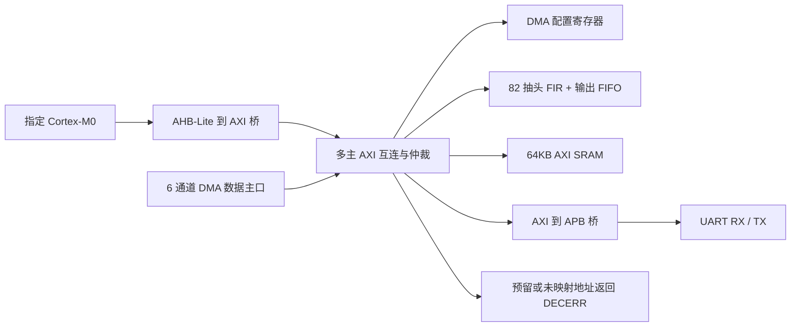

# 初赛工程跑测与修复报告

> 文档信息 ｜ 类别：验证与报告类 ｜ 所属：初赛检查 ｜ 状态：快照 ｜ 索引：`docs/README.md §1.4`
检查范围：用户提供的完整工程、初赛评分图片、评委问答及宣讲录音转写。按用户确认，本次不做上板测试。工程路径为 `<仓库根目录>`。

起始版本：`354a6ed`（main，工作区起始为干净状态）。修改分支：`audit/preliminary-validation`。未覆盖用户原有修改；保留原阶段文档和任务划分。

## 结果

- 全量编译及独立 RTL 回归：改前 24/24 PASS，改后 26/26 PASS。
- 指定 Cortex-M0 真核执行重新编译的 C 固件，完成 SRAM/FIR/DMA 冒烟、FIR×DMA 端到端及 8 字节 UART 回显；CPU AXI 协议违规数为 0。
- FIR 默认更正为 82 抽头（81 阶），全部系数独立可配置，保留 5 拍流水与 1 sample/cycle 内核吞吐。
- RTL 的 337 个有效输出与定点黄金模型逐位一致；直接与未量化浮点参考比较的 RRMSE 为 0.010466% < 0.1%。
- Vivado 2026.1 对 `xc7z020clg400-1` 完成完整顶层综合、优化、布局、物理优化和布线。20ns / 50MHz：布线后 WNS=+0.217ns、WHS=+0.036ns，TNS/THS=0，满足 25MHz 下限与 50MHz 目标。实际最高频率未做扫频测量，不将综合估计冒充实测 Fmax。
- 参考实现全部可布线网络已完成布线，路由错误为 0。没有内部未约束时序终点或组合环；没有综合推断锁存器、多驱动错误。

## 实际验证拓扑



真核测试加载 C 固件并观察 SRAM 信箱与 UART 引脚；CPU-free 集成用独立 AXI BFM 与 DMA 争用上述真实互连，不替换 FIR、DMA、SRAM 或 UART 逻辑。

## 需求与证据

| 初赛工程要求 | 验证证据 | 结果 |
|---|---|---|
| 指定 CPU 正常运行、UART 回显 | `tb_soc`、`tb_soc_probe`、`tb_uart_echo`；真实 CPU 固件和真实 UART/APB 拓扑 | PASS |
| 81 阶、82 个 16bit 可配系数；16bit 数据 | `fir_core`/`fir` 默认 NTAP=82；`tb_fir_asymmetric` 单独启用 h[81] 并验证任意非对称系数 | PASS |
| FIR 内核吞吐 ≥1 sample/cycle | 契约测试连续 en、5 拍 valid；非对称测试连续/间断输入逐项计分 | PASS，指内核，不把 AXI/DMA 带宽当作内核吞吐 |
| FIR 相对均方根误差 <0.1% | `tb_fir` 导出的真实 RTL 输出，由 `fir_coeff.py --check` 计算浮点 RRMSE | 0.010466% |
| DMA 6 通道独立配置、无数据错误、完成中断 | DMA 单元、六通道争用真实 SRAM 的集成测试、真核 C 驱动 | PASS |
| 多主 AXI、单拍/INCR、仲裁无死锁；AHB/AXI/APB 桥 | `tb_axi_ic` 527 项、DMA×互连、AHB 等待/BUSY/错误、APB 等待/超时及真实集成 | PASS |
| 片内存储可综合 | 64KB SRAM 推断为 16 个 RAMB36；FIFO 推断 LUTRAM | PASS |
| FPGA ≥25MHz | 参考 Zynq-7020 完整布局布线 50MHz，setup/hold 均通过 | PASS（参考器件，未绑定板卡） |
| RTL、TB、C 驱动与验证说明 | 仓库 `RTL/`、`TB/`、`sw/`；本报告及原始结果 | 工程文件齐全；比赛展示材料不在本次制作范围 |

评委问答中第 13、18 条明确了 82 个抽头及任意非对称系数，第 19 条明确采用相对均方根误差；第 3、4、7 条允许 Zynq-7020 PL 与 Vivado。本次使用用户提供的本地 Excel 原文，不依据另一个 agent 的猜测替代要求。

## 修复记录

### 1. DMA 配置突发预检形成超长组合路径

现象：50MHz 下时序不收敛。完整顶层基线综合 WNS 为 -95.215ns；第一次 OOC 诊断为 -95.126ns，两份报告均保留，统计方式不混淆。

关键路径：`u_dma/u_aw_arb/ptr_reg[0]` → `u_dma/u_regs/w_err_reg`，数据路径 115.079ns、195 级逻辑。主因在 `RTL/dma_regs.v:141` 的 `f_wburst_ok`：对运行时 LEN 逐拍枚举，综合形成最多 256 拍的串联检查。不能仅凭路径起点位于仲裁器就把问题归结为互连。

修改：DMA 寄存器合法地址是连续区间，INCR 地址单调递增，改用首地址、末地址及第 33 位溢出检查；FIXED 只检首地址。整笔预检失败仍无寄存器副作用。接口和握手拍序不变。

验证：新增 `tb_dma_precheck`，用原逐拍算法独立比对 165,891 组地址/长度/大小/FIXED/INCR，包括区间边缘及地址溢出；全过。真实 DMA、互连、CPU 系统测试全过。最终布线 WNS +0.217ns。

### 2. FIFO 无法有效推断存储器

现象：基线 67,115 FF、45,254 LUT；FIFO 存储体在带异步复位的时钟块中写入，导致大量触发器和读出多路器。

修改：`RTL/sync_fifo.v:49` 将存储写入放在无异步敏感项的同步块，使用 rst_n/clr/wen/full 门控；指针、计数仍按原方式复位。保留组合队首和原来的读写/满空行为，没有调用厂商 FIFO IP。

验证：非 2 次幂深度回卷、同时读写、DMA FIFO/FIR 输出 FIFO/UART 接收 FIFO 的回归全过。最终资源见下表，FIFO 已映射 LUTRAM。

### 3. 仲裁器运行时取模

修改：`RTL/axi_arbiter.v:39` 的 `(ptr+i)%N` 改为固定索引的两段优先扫描，先扫描 ptr 及其后，再回绕。保留锁定授权、背压稳定与 round-robin 推进语义，避免非 2 次幂路数下的宽取模逻辑。

验证：互连 527 项、6 路公平轮转/背压锁定、6 通道 DMA 回归通过。该修改是结构优化；主时序根因是上面的 DMA 突发预检，不将两者混为一谈。

### 4. FIR 阶数、向量及误差口径不一致

现象：原默认 NTAP=81 实际只有 80 阶；原脚本以满量程绝对误差判断 0.1%，与评委确认的相对均方根误差不符。

修改：`RTL/fir_core.v:73`、`RTL/fir.v:86` 默认 NTAP=82；同步更新黄金模型、82 项系数头文件、C 向量、单元/集成 TB 和活跃接口契约。256 个真实样本加 82 个零，产生 338 个结果，去掉 flush 后一个前导零，得到 337 个完整卷积结果。末系数地址 0x40000244，区域末字节 0x40000247。

保留 16bit Q1.15、40bit 累加和输出截位/饱和。按 `sqrt(sum((RTL/32768-reference)^2)/sum(reference^2))` 计算 RRMSE，不以“定点逐位一致的 0%”替代浮点误差。基准是此次固定带内/带外复合测试向量，未声称所有任意输入在参考能量接近零时也具有同样的相对误差。

验证：`tb_fir_asymmetric` 共 976 个结果，覆盖默认第 82 个系数、非对称正负系数、连续吞吐、间断输入、运行时系数修改和 flush。内核与 AXI 输出/CPU×DMA 全链路通过。浮点 RRMSE 0.010466%。同时修正定点分析工具对偶数抽头不应另算中心项的假设，并用 81/82 抽头最坏界检查。

### 5. 复现脚本

- `sim/sim.cmd` 保留为一键入口；逐个编译并运行 TB，先做全部 RTL/TB 的联合编译查重。
- 真核和 phase6 测试都重新生成同源向量并编译 C 固件；默认禁止悄悄沿用旧 firmware.hex。`-AllowStaleFirmware` 仅为显式诊断选项，本次没有使用。
- 持久化每个 TB 的编译/运行日志、固件构建日志、汇总 JSON、源码 SHA-256 和真实 FIR 输出；FIR 的浮点误差检查进入一键门禁。
- `synth/run_synth.bat` 现在调用 `run_check.ps1`，自动发现 Vivado，使用唯一英文暂存目录及英文 TEMP/TMP，复制结果回工程。不再递归删除共享的固定临时目录。
- 为避免 Vivado Tcl 用户缓存对中文配置目录的处理错误，本次子进程设置 `XILINX_LOCAL_USER_DATA=NO`，退出后恢复原值，参考[厂商 Tcl 缓存说明](https://github.com/Xilinx/XilinxTclStore/wiki/Modify-an-App-in-the-Repository)。同时检查进程退出码、完成标记及主日志/终端的 ERROR 文本，不能仅凭存在 dcp 判定成功。
- 时钟约束在综合前读入；默认 20ns，可指定 40ns。流程包含 `opt_design/place_design/phys_opt_design/route_design`，布线后 setup/hold 有负 slack 即非零退出。
- XDC 采用受支持的约束语句；流程控制和周期替换放在 Tcl 中。为复位/串口同步器添加 ASYNC_REG 属性。

### 6. 默认错误从设备的复位与仅仿真断言

`RTL/axi_ic.v` 为默认 DECERR 从设备补全 ID、LEN、BEAT 共 6 个寄存器的复位，消除 Synth 8-7137 的置位/复位优先级告警，复位后无效周期的载荷也有确定值。`RTL/dma.v` 的 ID 契约打印放入 `ifndef SYNTHESIS`，保留仿真检查，避免综合将 X 检查转换为二态逻辑。修改后完整 26 个测试台再次通过，最终时序采用该版本重新实现的结果。

## 时序与资源

器件：`xc7z020clg400-1`，Vivado 2026.1 build 6511674；完整 SoC，64KB SRAM，6 个 DMA 引擎，82 个 FIR 乘法器。无 OOC 模式、无黑盒替代 CPU、无放宽内部关键路径的 multicycle/false_path。

| 指标 | 起始版本完整顶层综合 | 修复后完整布线 |
|---|---:|---:|
| 时钟约束 | 20ns / 50MHz | 20ns / 50MHz |
| WNS | -95.215ns | +0.217ns |
| WHS | +0.132ns | +0.036ns |
| LUT | 45,254 | 12,782 |
| FF | 67,115 | 9,108 |
| LUTRAM | 0 | 1,238 |
| RAMB36 | 16 | 16 |
| DSP | 84（81 FIR + 3 CPU） | 85（82 FIR + 3 CPU） |

前一列是综合估计，后一列是完整布线结果，不把不同阶段的 WNS 当作相同精度。最终关键路径已转为 DMA 引擎到 SRAM 读地址检查，30 级逻辑。50MHz 的成功结果同时满足 ≥25MHz 的要求；未宣称已经验证 100MHz。

约束范围：clk 为唯一系统时钟；仅将外部异步 rst_n、uart_rxd 设 false_path，内部 reset recovery/removal 仍分析；UART TX 保留 min/max output delay 检查。check_timing 内部未约束终点、无时钟寄存器、组合环和 latch loop 均为 0。两个 no_input_delay 来自已声明异步 false_path 的外部输入。

## 告警审阅与未验证范围

没有隐藏关键告警。原始 DRC / methodology 报告保留在 `build/audit/`：

- UCIO-1：4 个外部端口没有指定开发板 PACKAGE_PIN。本次没有板卡，保留该 critical warning，不降低其严重级别，不生成供上板使用的 bitstream。
- ZPS7-1：Zynq PL 设计未实例化 PS7。评委问答允许纯 PL；本设计使用 RTL Cortex-M0。
- DSP DPIP/DPOP、DPIR-1：异步复位的外部流水寄存器无法合入 DSP 内部寄存器，属于进一步频率/面积优化建议；当前 routed setup/hold 已通过。
- SRAM REQP-1839、SYNTH-6/15、8-6841：异步控制、输出寄存器合并和 byte write enable 映射建议。功能仿真保留字节写入语义，SRAM 映射 16 个 RAMB36；物理板级复位过程未实测。
- XDCH-2：UART TX min/max 外部延时均取 0，是本次参考实现的显式保守约束，不代表某块板的外设时序规范。
- Icarus 5 条 timescale inherited 来自未修改的 ARM 附带文件；固件 $readmemh 文件短于 64KB SRAM 的提示来自先清零整块存储再加载有效程序的测试写法，未导致未初始化访问。

未做：板卡引脚/电气校验、bitstream 下载、真实 UART 终端、硬件启动镜像、门级 SDF 仿真、形式验证、跨工具版本/其他器件性能保证，以及比赛最终 PDF/PPT/视频制作。没有用这些未测项目替代已完成的 RTL 和布局布线证据。

## 回归对比

| 测试台 | 改前 | 改后 |
|---|---|---|
| `tb_ahb2axi` | PASS | PASS |
| `tb_axi_checker` | PASS | PASS |
| `tb_axi_ic` | PASS | PASS |
| `tb_axi_id_check` | PASS | PASS |
| `tb_axi_sram` | PASS | PASS |
| `tb_axi_to_apb` | PASS | PASS |
| `tb_dma` | PASS | PASS |
| `tb_dma_engine` | PASS | PASS |
| `tb_dma_ic` | PASS | PASS |
| `tb_dma_precheck` | 新增 | PASS |
| `tb_dma_self` | PASS | PASS |
| `tb_fifo_arbiter` | PASS | PASS |
| `tb_fir` | PASS | PASS |
| `tb_fir_asymmetric` | 新增 | PASS |
| `tb_fir_core` | PASS | PASS |
| `tb_fir_core_contract` | PASS | PASS |
| `tb_phase5_ahb` | PASS | PASS |
| `tb_phase5_integration` | PASS | PASS |
| `tb_phase5_sram` | PASS | PASS |
| `tb_phase6_fir_dma` | PASS | PASS |
| `tb_soc` | PASS | PASS |
| `tb_soc_bus` | PASS | PASS |
| `tb_soc_probe` | PASS | PASS |
| `tb_sram_offset` | PASS | PASS |
| `tb_uart_apb_edges` | PASS | PASS |
| `tb_uart_echo` | PASS | PASS |

另有 Python 工具测试 8/8 PASS。CPU-free 功能计划 bins 86/86；过程语句行覆盖 779/783=99.49%，范围不包括 CPU，不能将它称为全部 RTL 分支/条件/toggle 覆盖率。缺口为非法状态恢复与契约故意违规报错分支，原报告保留分母和缺口。

## 复现命令（cmd.exe）

先把 Icarus Verilog（iverilog/vvp）、Python 和 ARM GNU 工具链加入 PATH；Vivado 可在 PATH，也可使用脚本内本机安装位置。工具版本见下文。

```bat
cd /d <仓库根目录>
sim\sim.cmd
python -m unittest discover -s sim -p test_*.py -v
synth\run_synth.bat -Label rerun50
```

只验证初赛 25MHz 门槛：

```bat
synth\run_synth.bat -Period 40 -Label rerun25
```

重现起始版本的综合瓶颈，不切分支、不改当前工作区：

```bat
synth\run_synth.bat -SourceRef 354a6ed -SynthesisOnly -Label baseline-rerun
```

重新测量 CPU-free 计划覆盖和过程语句行：

```bat
python sim\phase5.py --line-coverage --report build\phase5\coverage-current.md
```

工具：Icarus Verilog 12.0 devel（s20150603-1539-g2693dd32b），Python 3.12.10，ARM GNU GCC 10.3-2021.10，Vivado 2026.1 BASIC。FIR 向量生成无需 scipy，标准库后备模型已运行；工具测试已检查标准库后备模型的截止频率及参考口径；本次未额外强制执行 SciPy 分支。

日志位置：`build/sim/` 保存 26 个 TB 结果和 SHA-256；`build/phase5/` 保存覆盖数据；`build/audit/` 保存本次基线、时序、工具检查。精选原始报告复制到 `docs/validation-20261018/`，可随 Git 提交留证，完整 dcp 和大型日志继续放在被忽略的 build 目录。

计时方法参照 AMD [Vivado UG906](https://docs.amd.com/r/en-US/ug906-vivado-design-analysis/Timing-Reports)，RAM 推断写法参照 [UG901](https://docs.amd.com/r/2025.1-English/ug901-vivado-synthesis/Distributed-RAM-Examples)。本报告的数值以本次实际日志为准。最终结果目录是 `build/audit/release50/`，该轮脚本退出码为 0，终端及主日志均无 ERROR，复位优先级及综合 X 比较转换告警已消除。
